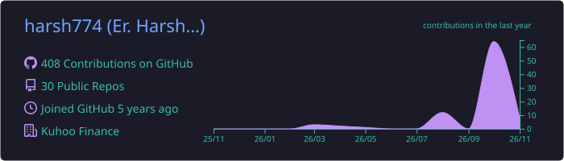
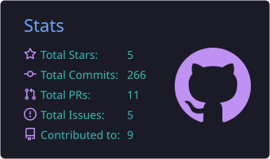
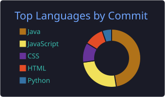
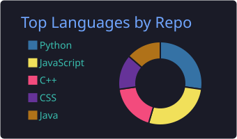
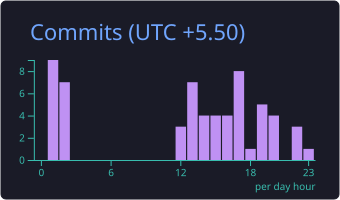

# Hey there, I'm Harsh 

  
  
  
  

  
  

---

## 👨‍💻 About Me

- 💼 **Software Engineer (SDE 1)** at **Kuhoo Finance**, an NBFC in Mumbai, working across **mobile, web and backend** on fintech products with **200K+ downloads**
- 🏗️ I own features end to end, from the API to the screen: architecture, LLD, development, testing and releases
- ⚡ Cut Android **p90 startup by ~55%**, moved a web app to Jaspr SSR for **90% faster loads** (3s to 300ms), and led a **VAPT** audit that fixed **50+ vulnerabilities**
- 🤖 Introduced a **spec-driven agentic AI workflow** that made feature delivery **40% faster**
- 🌱 Currently learning: **RabbitMQ**, **WebSockets / SSE**, and backend system design
- 🎓 B.Tech CSE, **VIT Bhopal**
- 💬 Ask me about: **Flutter, offline-first apps, API design, Clean Architecture, system design**

 

---

## 🧩 What I Do

<table>
<tr>
<td width="33%" valign="top">

### 📱 Mobile
- Cross-platform apps in **Flutter** (Android + iOS)
- Native **Swift / SwiftUI / UIKit** via platform channels
- **BLoC**, Clean Architecture, offline-first with **Drift (SQLite)**
- Push (**FCM / APNs**), deep linking, Keychain
- Releases with **Xcode, TestFlight, Fastlane**
- Performance: startup, app size, jank

</td>
<td width="33%" valign="top">

### ⚙️ Backend
- REST APIs with **FastAPI**, **Django** and **Node.js / Express**
- **SQL** (PostgreSQL, MySQL): schema design, joins, indexing, query tuning
- **Redis** caching
- Auth: **JWT, MFA**, Firebase Auth
- Idempotent sync APIs, ML model serving
- Microservices, message queues (**RabbitMQ**, learning)
- Security: **VAPT**, AES & RSA encryption

</td>
<td width="33%" valign="top">

### 🌐 Full Stack & Web
- End-to-end products: DB → API → UI
- Web apps with **React, Next.js, JavaScript**
- **Jaspr (SSR)** web apps, SEO-indexed pages
- Real-time: **WebSockets / SSE** (learning)
- CI/CD with **GitHub Actions**
- Monitoring: **Crashlytics, Mixpanel**
- **Agentic AI** workflows with Claude Code & Cursor

</td>
</tr>
</table>

---

## 🚀 Featured Work

| Project | What it is | Stack |
|---|---|---|
| 📱 **[Kuhoo Student App](https://play.google.com/store/apps/details?id=com.kuhoo.kuhoo_student_app)** · [App Store](https://apps.apple.com/in/app/kuhoo-education-loan-app/id6443475242) | Education-loan app with 200K+ downloads; resume-where-you-left journeys and post-loan self-service | Flutter, BLoC, Swift, Firebase |
| 🎓 **[College Compass](https://college-compass.kuhoo.com/)** | College & fee finder: 50K+ views, 20K+ users, 100+ paid subscribers | Jaspr (SSR), FastAPI, PostgreSQL, Gemini |
| 🌾 **[Khush-Hal](https://github.com/harsh774/Khushhal-Frontend)** | Offline-first MSME business-health app. **Top 10, NABARD Hackathon** | Flutter, Drift (SQLite), FastAPI, LightGBM |
| 🛒 **[AmazKart](https://github.com/harsh774/next-tailwind-amazkart)** | Amazon-style e-commerce web app with product listing, cart and checkout flow | Next.js, React, Tailwind CSS |
| 🧠 **[OpenAI Summarizer](https://github.com/harsh774?tab=repositories&q=summarizer)** | AI tool that turns long articles and text into short summaries | React, JavaScript, OpenAI API |

---

## 🛠️ Tech Stack

**Languages**

  
  

**Mobile & Web**

  

  
  
  
  
  
  

**Backend & Databases**

  

  
  
  
  
  

## 🧰 Tools I Use

  

  
  
  
  
  
  

**🤖 AI tools:**

---

## 🧠 Problem Solving & DSA

- ✅ **500+** DSA problems solved in Java on [LeetCode](https://leetcode.com/u/Harsh_Singh23_/)
- 🏆 Ranked **45th of 1,000** at CODSPIRE (AITR Indore Hackathon) · **AIR 7239** in CodeKaze'23
- ⭐ HackerRank 5★ · LeetCode 3★ · GFG 2★

  

---

## 📊 GitHub Stats

  

  
  

  
  

  

  <picture>
    <source media="(prefers-color-scheme: dark)" srcset="https://raw.githubusercontent.com/harsh774/harsh774/output/github-snake-dark.svg"/>
    <source media="(prefers-color-scheme: light)" srcset="https://raw.githubusercontent.com/harsh774/harsh774/output/github-snake.svg"/>
    
  </picture>

---

## 🎖️ Badges

  

---

## 📫 Reach Me Out

I'm open to **Software Engineer roles across mobile, backend and full stack**. Let's talk!

  
  

  

